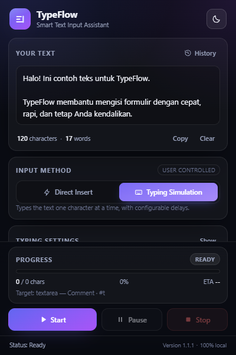

# TypeFlow

**Smart Text Input & Typing Assistant** — a Manifest V3 browser extension that inserts or
types prewritten text into web forms. Everything runs locally in your browser; no servers,
analytics, or telemetry.

TypeFlow is useful on discussion boards, support portals, and other sites where pasting is
disabled, where fields are `contenteditable`, or where you simply need to enter a long
response by hand.

---

## Highlights

- **Direct Insert** — inserts the whole text at the cursor in a single step.
- **Typing Simulation** — types one grapheme at a time with configurable speed and pauses.
- **Framework-aware input** — uses native value setters plus `beforeinput` / `input` events,
  so React and other controlled fields see a real change.
- **Multiple field types** — textareas, text-like inputs, `contenteditable`, and common
  rich-text editors where compatible, with a synthetic paste fallback for editors that reject
  direct DOM input.
- **Smart target detection** — remembers the focused field, finds editors inside open shadow
  roots and dynamically created same-origin iframes, and falls back to the largest visible
  editor with a visible warning.
- **Embedded editor support** — if the reply box is in a cross-origin iframe, TypeFlow offers
  an explicit **Allow editor site** action for that origin.
- **Live progress** — characters completed, total, percentage, ETA, and a toolbar badge.
- **Pause / Resume / Stop** — responsive at any point, including the start countdown.
- **Survives popup close** — typing continues in the page; reopening the popup restores
  progress.
- **Draft autosave + local history** — your draft and up to 25 recent texts stay on-device.
- **Dark and light themes** — compact, responsive popup with reduced-motion support.



> **Transparency note:** JavaScript-generated events are not trusted native keystrokes.
> TypeFlow uses standard DOM insertion and input events and does not attempt to disguise
> automation. A small number of sites reject programmatic input; see
> [docs/COMPATIBILITY.md](docs/COMPATIBILITY.md).

---

## Installation

### Requirements

- Chromium-based browser, version **110+** (Chrome, Edge, Brave, Opera, Vivaldi, …).
- Node.js **20+** for building from source.

### Build from source

```bash
npm install
npm run build
```

The production extension is written to `dist/`.

1. Open `chrome://extensions`.
2. Enable **Developer mode**.
3. Click **Load unpacked** and select the `dist` folder.
4. Pin **TypeFlow** to the toolbar.

Alternatively, run `npm run package` to produce
`release/typeflow-1.1.1.zip` and unzip it anywhere before loading it unpacked.

> Chrome 137+ no longer accepts `--load-extension` on branded builds. Use the
> `chrome://extensions` → **Load unpacked** flow, or use Chrome for Testing for automation.

---

## Usage

1. Open the page that contains your form.
2. **Click inside the text field** so it is focused.
3. Open TypeFlow from the toolbar.
4. Write or paste your text into the editor.
5. Pick **Direct Insert** or **Typing Simulation**.
6. Adjust typing settings if needed.
7. Press **Start**.
8. Watch progress; **Pause**, **Resume**, or **Stop** at any time.

Closing the popup does **not** stop typing. Reopen it to see live progress again.

### Keyboard shortcuts (inside the popup)

| Shortcut | Action |
| --- | --- |
| `Ctrl/Cmd + Enter` | Start |
| `Esc` | Stop the active typing operation |

### If no field is detected

TypeFlow first uses the field that was focused, then the last remembered field in the page,
then the largest visible editable field as a fallback. If the popup shows
“No editable field detected”, click the target field on the page and reopen TypeFlow.

---

## Typing settings

| Setting | Default | Description |
| --- | --- | --- |
| Speed | Normal | **Slow** 140 ms, **Normal** 55 ms, **Fast** 12 ms per character |
| Custom delay | — | Random delay between your **Min** and **Max** values (1–5000 ms) |
| Paragraph pause | 500 ms | Extra pause after each newline / paragraph break |
| Start countdown | 3 s | Delay before typing begins (0–30 s) |

Delays are intentional configuration, not fake “humanization”. TypeFlow never inserts
random mistakes or hides its activity.

---

## Permissions and privacy

| Permission | Why it is needed |
| --- | --- |
| `storage` | Saves the draft, settings, and local history with `chrome.storage.local` |
| `activeTab` | Grants temporary access to the tab where you opened TypeFlow |
| `scripting` | Injects the content script into that tab on demand |
| Optional site access | Only if you click **Allow editor site** when the reply box is inside a cross-origin iframe; grants access to that editor’s origin only |

TypeFlow intentionally requests **no host permissions up front** and makes no network
requests. If a forum hosts its editor in a cross-origin iframe, the popup shows an
**Allow editor site** button and Chrome asks you to approve that specific origin; you can
decline, and the permission remains ungranted. The content script runs only in frames
you opened TypeFlow on (plus any origin you explicitly approved).
Text never leaves the device. Drafts and history can be cleared from the popup.

---

## Development

```bash
npm install
npm run typecheck   # strict TypeScript, no emit
npm test            # unit tests (Node test runner + jsdom)
npm run e2e         # browser E2E (see docs/TESTING.md for prerequisites)
npm run build       # production build → dist/
npm run dev         # rebuild on change → dist/
npm run package     # zip the production build → release/
npm run icons       # regenerate PNG icons
```

`npm run verify` runs typecheck, unit tests, and the production build.

### Project layout

```
typeflow/
├── src/
│   ├── manifest.json
│   ├── background/service-worker.ts   # defaults, per-tab progress badge
│   ├── popup/                         # popup UI (HTML, CSS, TS)
│   ├── content/
│   │   ├── content.ts                 # content API + message bridge
│   │   ├── insertion.ts               # target detection + field adapters
│   │   └── typing-engine.ts           # countdown, typing loop, pause/stop, ETA
│   ├── storage/storage.ts             # chrome.storage.local persistence
│   ├── shared/                        # types, constants, message guards
│   └── utils/                         # text, timer, DOM helpers
├── scripts/                           # build, icons, zip, browser E2E
├── tests/                             # unit tests
├── docs/                              # architecture, compatibility, testing
├── assets/                            # generated PNG icons
├── dist/                              # production build (generated)
├── package.json
└── tsconfig.json
```

### Build output

```
dist/
├── manifest.json
├── background/service-worker.js
├── content/content.js
├── popup/{index.html,popup.css,popup.js}
└── assets/{icon16.png,icon48.png,icon128.png}
```

---

## Documentation

- [Architecture](docs/ARCHITECTURE.md) — components, message flows, insertion strategies.
- [Compatibility & limitations](docs/COMPATIBILITY.md) — what works, what does not, and why.
- [Testing](docs/TESTING.md) — automated coverage, browser E2E, manual checklist.

---

## Known limitations (summary)

- Synthetic DOM events are not trusted; sites that require trusted `isTrusted` events will
  reject input.
- Cross-origin iframes and restricted pages (`chrome://`, the Web Store, some PDF viewers)
  cannot be scripted.
- Canvas-based or proprietary editors with no real DOM editing surface are not supported.
- Password fields are intentionally excluded from supported input types.
- Very large typing jobs are bounded by configured delays and browser background-tab timer
  throttling; direct insertion handles large text instantly.

See [docs/COMPATIBILITY.md](docs/COMPATIBILITY.md) for details and troubleshooting.

---

**Version 1.1.1** · 100% local · No telemetry
